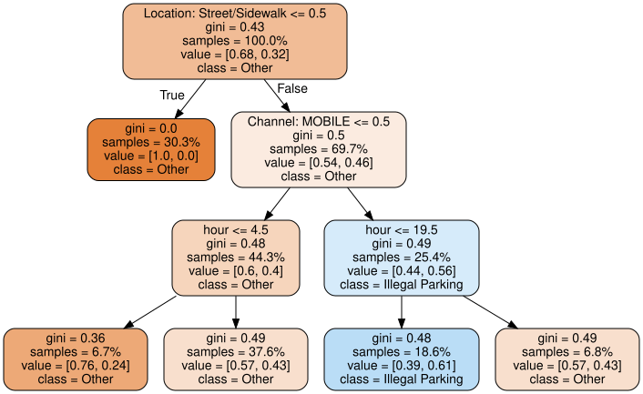

## What are decision trees and why do we use them?

A decision tree is used to make predictions or classify information by breaking a problem down into a sequence of simple yes or no questions.

- Decision trees learn rules from labeled examples.
- They make predictions by asking a sequence of questions.
- Their paths are relatively easy to interpret.

- **Classification:** predict a categorical outcome
- **Regression:** predict a numeric outcome


## How Does a Tree Work?

- **Root Node:** the first node at the tree that asks the question to split the data.
- **Branch:** the lines that connect the nodes, they represent the outcome of a question.
- **Internal Node:** Sub-decision points between the root and leaves.
- **Leaf:** the final terminal nodes at the bottom.

## Example

```text
                 [ What is the weather? ]  <-- Root Node
                 /         |           \
                /          |            \
          ( Sunny )     ( Cloudy )     ( Rainy )  <-- Branches
            /               |             \
           /                |              \
   [ Is humidity high? ]  [Hiking]       [Stay Inside] <-- Leaf Nodes
       /          \
      /            \
  ( High )      ( Normal )
     /              \
    /                \
[Swimming]         [Hiking]  <-- Leaf Nodes

```


## How does a tree choose a split?

For a node with class proportions $(p_1,\ldots,p_K)$, the **Gini impurity** is

$$ 
G = 1-\sum_{k=1}^{K}p_k^2 
$$


- (G = 0): the node contains one class only.
- Larger (G): the classes are more mixed (more impure)
- The algorithm searches for a split that reduces impurity.

## What does the tree learn?
Calculate split:
$$
G_{\text{split}} = \frac{n_L}{n} G_L + \frac{n_R}{n} G_R 
$$

Calculate reduction:
$$ 
\text{Reduction} = G_{\text{parent}} - G_{\text{split}}
$$

At each node:

1. Considers candidate features and thresholds/categories.
2. Measures how much the split reduces impurity.
3. Chooses the best split.


## An Example

| Study hours | Practice quizzes | Result |
|---:|---:|---|
| 1 | 0 | Fail |
| 1 | 1 | Fail |
| 2 | 0 | Fail |
| 2 | 1 | Fail |
| 3 | 0 | Pass |
| 3 | 1 | Pass |
| 4 | 0 | Pass |
| 4 | 1 | Pass |

In this dataset, study hours perfectly separate the two classes.

## Train a Decision Tree

```{python}
from sklearn.tree import DecisionTreeClassifier, export_text

X = [
    [1, 0], [1, 1],
    [2, 0], [2, 1],
    [3, 0], [3, 1],
    [4, 0], [4, 1]
]

y = [
    "Fail", "Fail",
    "Fail", "Fail",
    "Pass", "Pass",
    "Pass", "Pass"
]
model = DecisionTreeClassifier(
    max_depth=2,
    random_state=0
)

model.fit(X, y)

print(export_text(
    model,
    feature_names=["study_hours", "practice_quizzes"]
))
```

## Interpretation

```{python}
prediction = model.predict([[4, 0]])[0]
print("Prediction:", prediction)
```

The student studied four hours, which exceeds the learned threshold of 2.5 hours meaning they are predicted to pass.

## Example: NYC 311

**Question:** Can a small decision tree classify whether an NYPD 311 request is an **Illegal Parking** request?

Data Used:

- **41,955** NYPD 311 requests
- **13,370** Illegal Parking requests (**31.9%**)

Predictors used:

- hour of creation
- day of week
- open-data channel
- borough and location type

## Setup
```{python}
from pathlib import Path
from zipfile import ZipFile

import pandas as pd
from sklearn.model_selection import train_test_split

# Load the attached ZIP
DATA_ZIP = Path("data") / "311_nypd_lbdwk_2026.csv.zip"

with ZipFile(DATA_ZIP) as z:
    csv_name = z.namelist()[0]
    with z.open(csv_name) as f:
        d = pd.read_csv(
            f,
            dtype={"Unique Key": "string", "Incident Zip": "string"},
            parse_dates=["Created Date", "Closed Date"],
        )

# Target: Illegal Parking vs. all other requests.
d["target_illegal_parking"] = (
    d["Problem (formerly Complaint Type)"] == "Illegal Parking"
).astype(int)

# Predictors available at request creation time.
d["hour"] = d["Created Date"].dt.hour
d["day_of_week"] = d["Created Date"].dt.day_name()
d["channel"] = d["Open Data Channel Type"].fillna("Missing")
d["borough"] = d["Borough"].fillna("Missing")
d["location_type"] = d["Location Type"].fillna("Missing")

features = ["hour", "day_of_week", "channel", "borough", "location_type"]

X = d[features]
y = d["target_illegal_parking"]

X_train, X_test, y_train, y_test = train_test_split(
    X, y, test_size=0.25, random_state=42, stratify=y
)

print(f"Loaded {len(d):,} rows")
print(f"Illegal Parking: {y.sum():,} ({y.mean():.1%})")
```

## Fit a small tree

```{python}
from sklearn.pipeline import Pipeline
from sklearn.compose import ColumnTransformer
from sklearn.preprocessing import OneHotEncoder
from sklearn.tree import DecisionTreeClassifier

# Numeric variable
numeric_features = ["hour"]

# Categorical variables
categorical_features = [
    "day_of_week",
    "channel",
    "borough",
    "location_type"
]

# Preprocess numeric and categorical variables
preprocessor = ColumnTransformer(
    transformers=[
        ("numeric", "passthrough", numeric_features),
        (
            "categorical",
            OneHotEncoder(
                handle_unknown="ignore",
                sparse_output=False
            ),
            categorical_features
        )
    ]
)

# Decision tree
model = Pipeline([
    ("pre", preprocessor),
    ("tree", DecisionTreeClassifier(
        max_depth=3,
        criterion="gini",
        random_state=42
    ))
])

# Fit
model.fit(X_train, y_train)

print("Model fitted")
```

## The learned tree

<div class="r-stretch">
  
</div>

## Interpretation

Suppose a request has:

**Location Type = Street/Sidewalk**  
→ **Channel = MOBILE**  
→ **Hour ≤ 19:30**

The tree sends it to the **Illegal Parking** leaf.

> In this fitted model, that combination of observed features is associated with a higher share of Illegal Parking requests than the alternatives along the path.

## How well did it classify?

We held out **25%** of the data for testing.

| Metric | Result |
|---|---:|
| Majority-class baseline | **68.1%** |
| Tree accuracy | **72.4%** |
| Precision | **61.6%** |
| Recall | **36.0%** |

The tree improves on the simple majority baseline, but many Illegal Parking requests are still missed.

**Accuracy is not the whole story**

Because only about **31.9%** of requests are Illegal Parking, a model can look decent on accuracy while missing many positive cases.

## What happens if we change max_depth

```{python}
max_depth=2
max_depth=3
max_depth=5
max_depth=None
```

Results:

- **Shallow tree:** simpler, less flexible
- **Deeper tree:** more flexible, harder to explain
- **Very deep tree:** higher risk of overfitting

The goal is not “the deepest tree possible.” The goal is enough complexity to capture useful structure without losing generalization or interpretability.

## What can go wrong?

**1. Overfitting**  
The tree grows too complex and memorizes the training data instead of learning the general pattern.

**2. High Variance and Instability**  
A change in variation  in the training data can change the tree's sturcture and split points.

**3. Greedy Algorithm Shortcomings**  
The algorithm makes the best local choice at each individual split point without looking ahead, which means it rarely finds the globally optimal tree structure. 

**4. Computational Cost**  
Growing, sorting candidate split fields, and pruning large trees can become slow and expensive, especially with massive datasets. 

## Decision trees vs. other models

| Method | Strength | Trade-off |
|---|---|---|
| Decision tree | Easy to explain as rules | Can be unstable / overfit |
| Logistic regression | Compact coefficient interpretation | Linear decision boundary |
| Random forest | Usually stronger predictive performance | Less transparent |
| Gradient boosting | Powerful predictive model | More tuning + less simple |

## Takeaways

1. **Trees turn predictors into a sequence of if/then decisions.**
2. **Gini impurity** measures how mixed a node is; splits seek more homogeneous children.
3. **Depth and leaf-size constraints** help control overfitting.
4. **Accuracy is not enough** when classes are imbalanced.
5. **A predictive split is not a causal explanation.**

## Sources

::: {#refs}
:::
